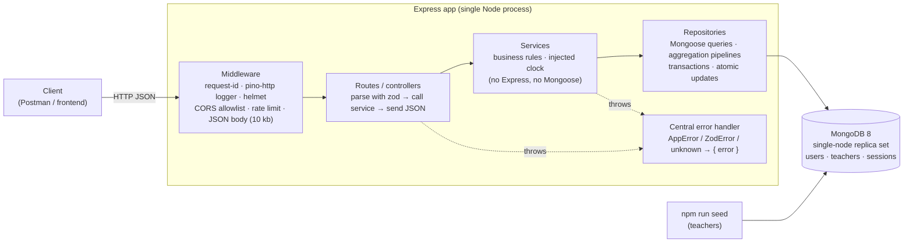
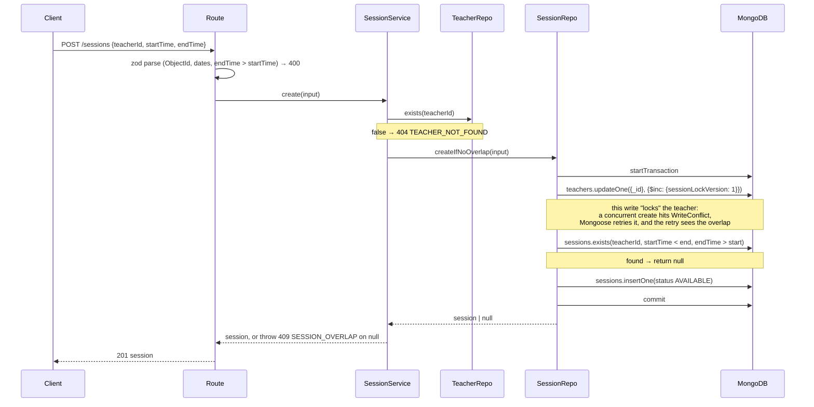
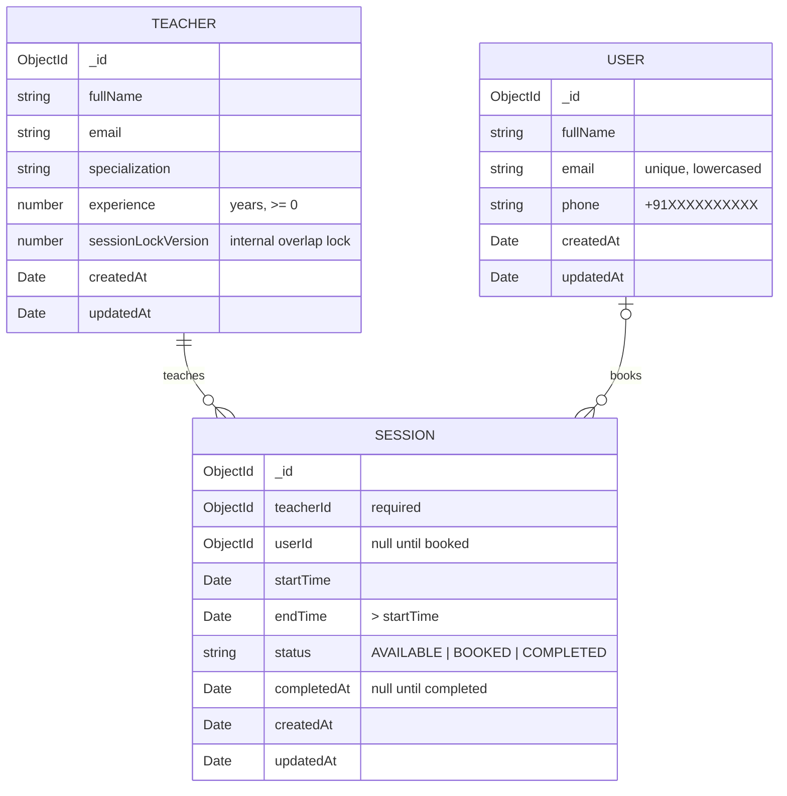

# Architecture

Scope comes from [REQUIREMENTS.md](REQUIREMENTS.md). Decision IDs (D-xxx) point to [DECISIONS.md](DECISIONS.md).

## 1. Architecture diagram



**Layer rules**

| Layer | Knows about | Never touches |
|---|---|---|
| Routes / controllers | Express `req`/`res`, zod schemas, services | Mongoose |
| Services | Domain rules, repository functions, `clock()` | Express, Mongoose |
| Repositories | Mongoose models, pipelines, transactions | Express, HTTP status codes |

Services receive their repositories and clock as arguments (`createSessionService({ sessionRepo, userRepo, clock })`). Unit tests pass in-memory fakes and a fixed clock, so business rules run without HTTP or a database. `createApp({ clock })` wires the real ones.

### Create-session flow (the only multi-step write)



## 2. Data model



All three use Mongoose `timestamps: true` and `versionKey: false` — no `__v` anywhere, so nothing needs hiding from responses. Teachers carry an explicit `sessionLockVersion` counter, the overlap lock (D-008, D-023); it's internal and never returned by the API.

**Indexes**

| Collection | Index | Serves |
|---|---|---|
| users | `{ email: 1 }` unique | F1 uniqueness, enforced by the DB (no check-then-insert race) |
| sessions | `{ status: 1, startTime: 1 }` | F3 — status + date range, already sorted by `startTime` |
| sessions | `{ teacherId: 1, startTime: 1 }` | F2 overlap lookup for one teacher |
| sessions | `{ userId: 1, status: 1 }` | F6 — one user's booked/completed sessions |

Indexes are declared on the schemas. `server.ts` awaits `createIndexes()` for every model before it starts listening, so the unique email index is guaranteed before the first request; it only adds missing indexes and never drops any (D-024). No migration tool (D-001).

## 3. API endpoints

All bodies are JSON. Ids are 24-char hex ObjectIds; anything else is a `400`. Valid ids are parsed into `Types.ObjectId` at validation, so services, repositories and pipelines never handle id strings (D-028). Times in bodies accept ISO-8601 or epoch ms; responses return ISO-8601 (UTC).

| # | Method & path | Body / query | Success | Errors |
|---|---|---|---|---|
| F1 | `POST /users` | `{ fullName, email, phone }` | `201` user | `400` VALIDATION_ERROR · `409` EMAIL_ALREADY_EXISTS |
| F2 | `POST /sessions` | `{ teacherId, startTime, endTime }` | `201` session | `400` VALIDATION_ERROR · `404` TEACHER_NOT_FOUND · `409` SESSION_OVERLAP |
| F3 | `GET /sessions/available` | `?dateTimestamp=<epoch ms>` | `200` session[] with `teacher` | `400` VALIDATION_ERROR |
| F4 | `POST /sessions/:id/book` | `{ userId }` | `200` session | `400` · `404` USER_NOT_FOUND / SESSION_NOT_FOUND · `409` SESSION_NOT_AVAILABLE / SESSION_ALREADY_STARTED |
| F5 | `PATCH /sessions/:id/complete` | — | `200` session | `400` · `404` SESSION_NOT_FOUND · `409` SESSION_NOT_BOOKED |
| F6 | `GET /users/:id/sessions` | — | `200` `{ upcoming, completed }` with `teacher` | `400` · `404` USER_NOT_FOUND |
| — | `GET /health` | — | `200` `{ status: "ok", db: "up" }` | `503` `{ status: "error", db: "down" }` |

Common to every route: `404` ROUTE_NOT_FOUND, `400` INVALID_JSON, `413` PAYLOAD_TOO_LARGE, `429` RATE_LIMITED, `500` INTERNAL_ERROR.

**Success shape** — the resource itself, no envelope (D-016):

```json
{
  "_id": "6650f0c2a1b2c3d4e5f60789",
  "teacherId": "6650f0c2a1b2c3d4e5f60001",
  "userId": null,
  "startTime": "2026-10-21T04:30:00.000Z",
  "endTime": "2026-10-21T05:30:00.000Z",
  "status": "AVAILABLE",
  "completedAt": null,
  "createdAt": "2026-10-20T10:00:00.000Z",
  "updatedAt": "2026-10-20T10:00:00.000Z"
}
```

F3 / F6 items add `"teacher": { "_id", "fullName", "specialization" }`.

**Error shape** — every error, from every layer:

```json
{
  "error": {
    "code": "SESSION_NOT_AVAILABLE",
    "message": "Session is already booked",
    "details": [],
    "requestId": "0b9c1c8e-6a51-4c43-9d1e-2f5c7a0e9b11"
  }
}
```

`details` appears only for `VALIDATION_ERROR` (field path + message per zod issue).

### Aggregation pipelines (mandatory for F3 and F6)

**F3** — the service turns `dateTimestamp` into an IST day range `[dayStart, dayEnd)` with a pure function (fixed +05:30 offset, no DST), then:

```js
[
  { $match: { status: 'AVAILABLE', startTime: { $gte: dayStart, $lt: dayEnd, $gt: now } } },
  { $sort: { startTime: 1 } },
  { $lookup: { from: 'teachers', localField: 'teacherId', foreignField: '_id', as: 'teacher',
               pipeline: [{ $project: { fullName: 1, specialization: 1 } }] } },
  { $unwind: '$teacher' }
]
```

Computing the range in the app (not `$dateToString` with a timezone inside the pipeline) keeps `$match` on a plain range, so it uses the `{ status, startTime }` index (D-019).

**F6**

```js
[
  { $match: { userId, status: { $in: ['BOOKED', 'COMPLETED'] } } },
  { $lookup: { /* same teacher lookup */ } },
  { $unwind: '$teacher' },
  { $facet: {
      upcoming:  [{ $match: { status: 'BOOKED' } },    { $sort: { startTime: 1 } }],
      completed: [{ $match: { status: 'COMPLETED' } }, { $sort: { completedAt: -1 } }]
  } }
]
```

One round trip returns both lists (D-009: `upcoming` = every `BOOKED`).

## 4. Folder structure

```
.
├── src/
│   ├── app.ts                  # createApp({ clock }) — middleware, routes, error handler
│   ├── server.ts               # load config, create logger, connect DB, listen, graceful shutdown
│   ├── config.ts               # env vars parsed + validated with zod
│   ├── errors.ts               # AppError, error handler, 404 handler
│   ├── request-logger.ts       # pino-http + request id (incoming x-request-id or UUID)
│   ├── health.routes.ts
│   ├── validation.ts           # shared zod pieces: ObjectId (string → Types.ObjectId), `:id` params
│   ├── users/
│   │   ├── user.model.ts
│   │   ├── user.repository.ts
│   │   ├── user.service.ts
│   │   ├── user.routes.ts      # every /users route incl. /users/:id/sessions (D-015, D-029)
│   │   └── user.schemas.ts     # zod request schemas
│   ├── teachers/
│   │   ├── teacher.model.ts
│   │   ├── teacher.repository.ts
│   │   └── teacher.seed.ts     # seed data + idempotent upsert (used by scripts/seed.ts and tests)
│   ├── sessions/
│   │   ├── session.model.ts
│   │   ├── session.repository.ts   # pipelines, transaction, atomic updates
│   │   ├── session.service.ts      # create / available / book / complete / listForUser
│   │   ├── session.routes.ts       # /sessions/*
│   │   ├── session.schemas.ts
│   │   └── ist-day.ts              # pure: timestamp → IST day range
│   └── scripts/
│       └── seed.ts             # connects, runs seedTeachers(), prints ids
├── tests/
│   ├── unit/                   # services + pure functions, fakes + fixed clock, no DB
│   ├── fakes/                  # in-memory repositories implementing the real repository types
│   ├── integration/            # supertest + in-memory Mongo replica set
│   └── setup/                  # replica-set lifecycle, DB cleanup, fixtures
├── postman/englishyaari.postman_collection.json
├── docker-compose.yml          # mongo:8.2 single-node replica set
├── .env.example
├── .github/workflows/ci.yml
└── docs/
```

## 5. Security decisions

| Decision | Trade-off |
|---|---|
| **zod validation on every input** (body, params, query) before it reaches a service. Unknown body keys are stripped, so a client can't set `status`, `userId` or `completedAt` on create. | One schema per route to maintain. |
| **Type-safe queries only.** zod guarantees ids are hex strings and times are dates, so operator injection like `{ "$gt": "" }` never reaches Mongoose. (Mongoose `sanitizeFilter` is *not* used: it would also neutralise the `$gt`/`$lt` filters our own repositories build.) | Safety depends on every route parsing input first — enforced by tests on each endpoint. |
| **helmet** default security headers; `x-powered-by` off. | Defaults are tuned for HTML apps; harmless for a JSON API. |
| **CORS allowlist** from `CORS_ORIGINS` (comma-separated). Requests without an `Origin` (Postman, curl) are allowed. | Browser clients on other origins must be added to the env var. |
| **Rate limit** (`express-rate-limit`, in-memory, per IP; window and max from env) → `429 RATE_LIMITED`. | In-memory counters reset on restart and aren't shared across processes; fine for one local process. Upgrade path: Redis store. |
| **10 kb JSON body limit.** | Plenty for these payloads. |
| **No stack traces or raw DB errors in responses.** Unknown errors → generic `500`; full detail goes to logs with the request ID. | Clients must quote the `requestId` to get details. |
| **Secrets only via env**; `.env.example` committed, `.env` git-ignored. Config is validated at startup — the app refuses to start with a bad `MONGODB_URI`. | — |
| **No authentication** (out of scope). Anyone who can reach the API can book for any `userId`. | Documented risk; acceptable for a local assessment. |

## 6. Performance decisions

| Decision | Trade-off |
|---|---|
| **Indexes for every filter** (see §2). Each pipeline starts with an indexed `$match`. | Small write overhead per insert. |
| **`$match` → `$sort` → `$lookup`** in F3 so the teacher join only runs on the matching rows. | — |
| **IST range computed in the app**, not inside the pipeline (D-019), keeping the match index-friendly. | Timezone logic lives in TS, not Mongo — but it's a pure, unit-tested function. |
| **F6 uses one `$facet`** — one query returns both lists. | Facet output is one document (16 MB cap); a single user's sessions are nowhere near that. |
| **No pagination** (D-001): results are bounded to one IST day or one user. | A teacher-heavy day or a power user could return many rows. Upgrade path: `limit` + `cursor` on `startTime`. |
| **`lean()` reads** in repositories — plain objects, no Mongoose document overhead. | No document methods on results (not needed). |
| **No caching.** | Every request hits Mongo; fine at assessment scale. |

## 7. Reliability decisions

| Decision | Trade-off |
|---|---|
| **No teacher overlap, even under concurrency** (D-008): the overlap check and insert run in a transaction that first writes to the teacher doc (`$inc sessionLockVersion`). Two concurrent creates for one teacher conflict on that doc; Mongoose's `connection.transaction()` retries the loser, which then sees the overlap. | Needs a replica set (docker-compose provides one). Creates for the same teacher are serialised. |
| **Booking is one atomic conditional update** — `findOneAndUpdate({ _id, status: 'AVAILABLE', startTime: { $gt: now } }, { status: 'BOOKED', userId })`. Two users racing for a session: exactly one gets it, the other gets `409`. No transaction needed (one document). | The service reads the session first to return a precise error (`404` / `409` reason); the atomic update is what actually guarantees correctness. |
| **Completing is the same pattern** — `{ _id, status: 'BOOKED' }` → `COMPLETED`, `completedAt = now`. | — |
| **Email uniqueness: explicit check + unique index** (D-025). The service checks `existsByEmail` first (rule visible and unit-tested); if a simultaneous sign-up slips between check and insert, the unique index rejects it (`E11000`) and that also becomes `409`. | One extra query per sign-up. Correctness still rests on the index, which is created at startup (D-024). |
| **Injected clock** (`clock: () => Date`) used for "now" in F3, F4, F5. Tests pass a fixed date. | One extra constructor argument per service. |
| **Health check** `GET /health` reports DB connectivity (`503` when Mongo is down). | — |
| **Structured logs** (pino JSON) with a request ID per request — taken from an incoming `x-request-id` header or generated, echoed back in the response header and in every error body. Each request line holds only id, method, url and status — never headers, so cookies or tokens can't leak into logs (D-030). | JSON logs are less readable raw; `pino-pretty` in dev. |
| **Graceful shutdown** on `SIGINT`/`SIGTERM`: stop accepting connections, then close Mongo. | — |
| **CI** (GitHub Actions) runs lint, type-check and the full test suite on every push. | mongod binary for tests is downloaded once per CI cache (D-014). |
